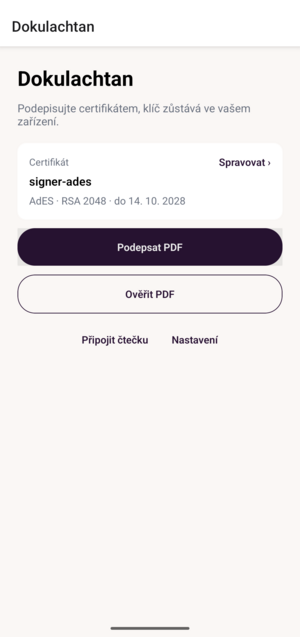
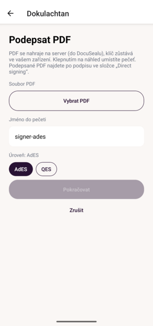
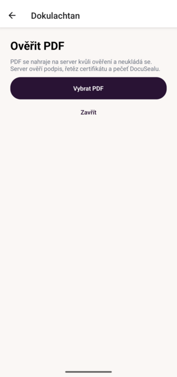

# Dokulachtan

**Podepiš dokument z mobilu certifikátem, který ti vydala iSignum. Klíč zůstane v tvém zařízení —
na server se nikdy nenahraje.**

Dokulachtan je open-source appka, která se napojí na upravený [DocuSeal](https://github.com/v1b3coder/docuseal).
Appka umí z mobilu podepisovat a ověřovat dokumenty certifikáty od iSignum (I.CA) a PostSignum.
Upravený DocuSeal přidává pole „Podpis certifikátem“, přímý podpis PDF a ověření PDF. Dokumenty,
e-maily, stav a audit zůstávají v DocuSealu, který si nainstaluješ u sebe; appka se k němu připojí přes API.

[**Stáhnout appku**](https://github.com/v1b3coder/dokulachtan/releases/latest) ·
[DocuSeal](https://github.com/docusealco/docuseal) ·
[Jak to funguje](#jak-to-funguje)

| Domů | Podepsat PDF | Ověřit PDF |
|:---:|:---:|:---:|
|  |  |  |

## Proč Dokulachtan

Stát k elektronickým podpisům nastavil pravidla. U nás díky tomu existují kvalifikované certifikační
autority — PostSignum a iSignum (I.CA). Můžeš si od nich pořídit kvalifikovaný certifikát a ten má právní
váhu: podpis jím je postavený na roveň vlastnoručnímu podpisu. To je dobrá zpráva.

Horší je software kolem toho. Nástroje pro práci s certifikáty jsou často jen pro Windows, proprietární,
nebo obojí. Podepsat PDF certifikátem z mobilu pak znamená ruční boj s několika aplikacemi, exportem klíčů
a hledáním, které okno vlastně chceš použít.

Lidi to proto řeší jinak. Někdo vloží do PDF naskenovaný obrázek svého podpisu a tváří se, že je dokument
podepsaný. To ale není elektronický podpis v právním smyslu — chybí kryptografická vazba na dokument i identita
podepisujícího. Někdo jiný to hodí na třetí stranu, jako DocuSign nebo SpotDraft. Ty umí podepisovat z mobilu
a mají slušné UX, ale důvěra v podpis stojí na přístupu k e-mailu a na tom, že třetí strana neprozradí odkaz
k podpisu. To je jiný model důvěry, než jaký dává kvalifikovaný certifikát.

Problém tedy není v tom, že by certifikáty nebyly. Problém je, že podepsat dokument certifikátem z mobilu je dnes
horší zážitek než vložit obrázek podpisu nebo kliknout na odkaz v cizí aplikaci.

Proto jsem se rozhodl udělat Dokulachtana. Jednoduchou appku, která umí z mobilu podepisovat a ověřovat
dokumenty certifikáty od iSignum (I.CA) a PostSignum. Klíč zůstává v telefonu nebo v čipu občanky, na server
se nikdy nenahraje. Když chceš pokročilý workflow — dokumenty, e-maily, stav a audit — Dokulachtan se
napojí na DocuSeal, který si nainstaluješ u sebe.

## Co umí

| Co | Jak |
|---|---|
| **Podepsat dokument z e-mailu** | Otevři odkaz, zkontroluj dokument a potvrď otisk. |
| **Podepsat PDF, které přišlo jinudy** | Vyber soubor v appce, nebo ho nasdílej z jiné aplikace. |
| **Ověřit cizí PDF** | Appka ti řekne, jestli je podpis platný, kdo ho udělal a jestli se soubor nezměnil. |
| **Vše zůstane v DocuSealu** | Podepsaný dokument, historie i audit jsou na jednom místě. |

## Jak to funguje

1. Přijde ti e-mail s odkazem na dokument.
2. Otevři odkaz a dokument si prohlédni.
3. Klepni na „Podepsat“ a potvrď otiskem prstu nebo PINem.
4. Hotovo — dokument je podepsaný a uložený, firma vidí stav.

Pro firmu se nic nemění: dokument nahraje do DocuSealu jako dnes, vybere, kdo má podepsat,
a sleduje stav. Nic dalšího se nezakládá.

| Co | Kde |
|---|---|
| Dokument, e-mail, historie, audit | DocuSeal |
| Podpis (AdES) | appka v telefonu |
| Podpis (QES) | čip občanky přes čtečku |
| Klíč | telefon nebo čip občanky — nikdy na serveru |

## Dvě úrovně podpisu

| | AdES | QES |
|---|---|---|
| **Kde je klíč** | v telefonu | v čipu občanky |
| **Co potřebuješ** | telefon | telefon a čtečku |
| **Co podpis umí** | průkazný podpis, ověřitelný v běžných nástrojích | má stejnou váhu jako vlastnoruční podpis |
| **Kdy** | pro většinu dokumentů | když to vyžaduje zákon nebo úřad |

Za podpis se neplatí. U QES potřebuješ čtečku a kvalifikovaný certifikát.

## Vyzkoušet

**Podepisuješ dokument?**

1. Otevři odkaz z e-mailu.
2. Zkontroluj dokument a klepni na „Podepsat“.
3. Potvrď otisk prstu nebo PIN.

**Chceš to provozovat?**

1. Nainstaluj si [upravený DocuSeal](https://github.com/v1b3coder/docuseal). Appka se k němu připojí přes API.
2. Stáhni si appku (Android 7.0+) z [Releases](https://github.com/v1b3coder/dokulachtan/releases/latest)
   a v *Nastavení* zadej Server URL a API token (DocuSeal → Nastavení → API).
3. V DocuSealu nahraj PDF, přidej pole „Podpis certifikátem“ a odešli.

APK z Releases je testovací build, ne ostrý podpis.

## Stav

- **Hotové:** podpis certifikátem v DocuSealu, Android appka (AdES i QES s testovacím čipem),
  přímý podpis PDF, ověření PDF, vícenásobné podpisy.
- **Zbývá:** první reálný podpis, reálná čtečka eObčanky a kvalifikované časové razítko.
- Detail a historie: [AGENTS.md](AGENTS.md#stav).

## Pro vývojáře

Vývoj, testy, nasazení a mapa dokumentace: [DEVELOPMENT.md](DEVELOPMENT.md).

- [DESIGN.md](DESIGN.md) — co a proč
- [SPEC.md](SPEC.md) — jak přesně (model, API, obrazovky, testy)
- [PLAN.md](PLAN.md) — fáze P0–P8
- [AGENTS.md](AGENTS.md) — pravidla repa a aktuální stav

## Licence

Fork vychází z [DocuSeal](https://github.com/docusealco/docuseal) (AGPL-3.0) a zůstává
AGPL-3.0 s uvedením autorství. Vlastní kód forku: <https://github.com/v1b3coder/docuseal>.
